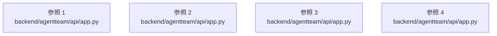

# dependency-map/group-1/n-backend-agentteam-api-app-py-880fa2

[解析トップへ戻る](../../../README.md)

確認済みファイル: `backend/agentteam/api/app.py`

解析: Python AST。静的なimport／export参照です。関数の実行順序やHTTP通信は表していません。

宣言: `CreateRunBody`, `PatchAgentBody`, `CreateAgentBody`, `PutConnectionBody`, `PutLimitsBody`, `ResolveApprovalBody`, `ForkBody`, `AdoptArtifactBody`, `InstructionBody`, `LoginBody`, `GrantBody`, `create_app`

- `__future__` → 外部・標準ライブラリ・別名など。ローカル対応先は未確定
- `asyncio` → 外部・標準ライブラリ・別名など。ローカル対応先は未確定
- `difflib` → 外部・標準ライブラリ・別名など。ローカル対応先は未確定
- `io` → 外部・標準ライブラリ・別名など。ローカル対応先は未確定
- `json` → 外部・標準ライブラリ・別名など。ローカル対応先は未確定
- `secrets` → 外部・標準ライブラリ・別名など。ローカル対応先は未確定
- `ipaddress` → 外部・標準ライブラリ・別名など。ローカル対応先は未確定
- `shutil` → 外部・標準ライブラリ・別名など。ローカル対応先は未確定
- `re` → 外部・標準ライブラリ・別名など。ローカル対応先は未確定
- `zipfile` → 外部・標準ライブラリ・別名など。ローカル対応先は未確定
- `urllib.parse` → 外部・標準ライブラリ・別名など。ローカル対応先は未確定
- `contextlib` → 外部・標準ライブラリ・別名など。ローカル対応先は未確定
- `pathlib` → 外部・標準ライブラリ・別名など。ローカル対応先は未確定
- `typing` → 外部・標準ライブラリ・別名など。ローカル対応先は未確定
- `fastapi` → 外部・標準ライブラリ・別名など。ローカル対応先は未確定
- `fastapi.responses` → 外部・標準ライブラリ・別名など。ローカル対応先は未確定
- `fastapi.staticfiles` → 外部・標準ライブラリ・別名など。ローカル対応先は未確定
- `pydantic` → 外部・標準ライブラリ・別名など。ローカル対応先は未確定
- `sse_starlette.sse` → 外部・標準ライブラリ・別名など。ローカル対応先は未確定
- `__version__` → 外部・標準ライブラリ・別名など。ローカル対応先は未確定
- `config.loader` → `backend/agentteam/config/loader.py`（一覧確認・内容未読）
- `config.models` → `backend/agentteam/config/models.py`（一覧確認・内容未読）
- `contracts` → `backend/agentteam/contracts.py`（内容確認済み）
- `ids` → `backend/agentteam/ids.py`（内容確認済み）
- `projections.views` → `backend/agentteam/projections/views.py`（内容確認済み）
- `providers.registry` → `backend/agentteam/providers/registry.py`（内容確認済み）
- `service` → `backend/agentteam/api/service.py`（一覧確認・内容未読）
- `security.accounts` → `backend/agentteam/security/accounts.py`（一覧確認・内容未読）
- `security.server` → `backend/agentteam/security/server.py`（内容確認済み）
- `store.job_store` → `backend/agentteam/store/job_store.py`（一覧確認・内容未読）
- `runtime.sandbox` → `backend/agentteam/runtime/sandbox.py`（一覧確認・内容未読）

## 要素の説明

### imports-1

import参照の表示用グループ。

[詳細な図と説明を見る](imports-1/README.md)

### imports-2

import参照の表示用グループ。

[詳細な図と説明を見る](imports-2/README.md)

### imports-3

import参照の表示用グループ。

[詳細な図と説明を見る](imports-3/README.md)

### imports-4

import参照の表示用グループ。

[詳細な図と説明を見る](imports-4/README.md)

