# dependency-map/group-1/n-backend-agentteam-api-app-py-880fa2/imports-3

[解析トップへ戻る](../../../../README.md)

import参照の表示用グループ。

```mermaid
graph TD
    source["ソース\nbackend/agentteam/api/app.py"]
    n-fastapi-staticfiles-4f0832["fastapi.staticfiles\n外部・別名・未解決"]
    source -->|"Python AST: import／export"| n-fastapi-staticfiles-4f0832
    n-pydantic-196fee["pydantic\n外部・別名・未解決"]
    source -->|"Python AST: import／export"| n-pydantic-196fee
    n-sse-starlette-sse-d7bc1d["sse_starlette.sse\n外部・別名・未解決"]
    source -->|"Python AST: import／export"| n-sse-starlette-sse-d7bc1d
    n-version-8c86bc["__version__\n外部・別名・未解決"]
    source -->|"Python AST: import／export"| n-version-8c86bc
    n-config-loader-f5abeb["config.loader\nbackend/agentteam/config/loader.py"]
    source -->|"Python AST: import／export"| n-config-loader-f5abeb
    n-config-models-3c5fce["config.models\nbackend/agentteam/config/models.py"]
    source -->|"Python AST: import／export"| n-config-models-3c5fce
    n-contracts-80cff8["contracts\nbackend/agentteam/contracts.py"]
    source -->|"Python AST: import／export"| n-contracts-80cff8
    n-ids-3adc09["ids\nbackend/agentteam/ids.py"]
    source -->|"Python AST: import／export"| n-ids-3adc09
```

## 要素の説明

### n-config-loader-f5abeb

参照名: `config.loader`

対応する実在ソース: `backend/agentteam/config/loader.py`。内容は未読。

### n-config-models-3c5fce

参照名: `config.models`

対応する実在ソース: `backend/agentteam/config/models.py`。内容は未読。

### n-contracts-80cff8

参照名: `contracts`

対応する実在ソース: `backend/agentteam/contracts.py`。内容確認済み。

### n-fastapi-staticfiles-4f0832

参照名: `fastapi.staticfiles`

ローカルのソース対応先を確定できませんでした。外部ライブラリ、標準ライブラリ、型別名などを区別する追加確認が必要です。

### n-ids-3adc09

参照名: `ids`

対応する実在ソース: `backend/agentteam/ids.py`。内容確認済み。

### n-pydantic-196fee

参照名: `pydantic`

ローカルのソース対応先を確定できませんでした。外部ライブラリ、標準ライブラリ、型別名などを区別する追加確認が必要です。

### n-sse-starlette-sse-d7bc1d

参照名: `sse_starlette.sse`

ローカルのソース対応先を確定できませんでした。外部ライブラリ、標準ライブラリ、型別名などを区別する追加確認が必要です。

### n-version-8c86bc

参照名: `__version__`

ローカルのソース対応先を確定できませんでした。外部ライブラリ、標準ライブラリ、型別名などを区別する追加確認が必要です。

### source

`backend/agentteam/api/app.py` の内容を確認しました。

