# dependency-map/group-1/n-backend-agentteam-api-app-py-880fa2/imports-4

[解析トップへ戻る](../../../../README.md)

import参照の表示用グループ。

```mermaid
graph TD
    source["ソース\nbackend/agentteam/api/app.py"]
    n-projections-views-b2bb96["projections.views\nbackend/agentteam/projections/views.py"]
    source -->|"Python AST: import／export"| n-projections-views-b2bb96
    n-providers-registry-8a1917["providers.registry\nbackend/agentteam/providers/registry.py"]
    source -->|"Python AST: import／export"| n-providers-registry-8a1917
    n-service-4cf5bc["service\nbackend/agentteam/api/service.py"]
    source -->|"Python AST: import／export"| n-service-4cf5bc
    n-security-accounts-f5c7f9["security.accounts\nbackend/agentteam/security/accounts.py"]
    source -->|"Python AST: import／export"| n-security-accounts-f5c7f9
    n-security-server-a6fd06["security.server\nbackend/agentteam/security/server.py"]
    source -->|"Python AST: import／export"| n-security-server-a6fd06
    n-store-job-store-45f489["store.job_store\nbackend/agentteam/store/job_store.py"]
    source -->|"Python AST: import／export"| n-store-job-store-45f489
    n-runtime-sandbox-f908a1["runtime.sandbox\nbackend/agentteam/runtime/sandbox.py"]
    source -->|"Python AST: import／export"| n-runtime-sandbox-f908a1
```

## 要素の説明

### n-projections-views-b2bb96

参照名: `projections.views`

対応する実在ソース: `backend/agentteam/projections/views.py`。内容確認済み。

### n-providers-registry-8a1917

参照名: `providers.registry`

対応する実在ソース: `backend/agentteam/providers/registry.py`。内容確認済み。

### n-runtime-sandbox-f908a1

参照名: `runtime.sandbox`

対応する実在ソース: `backend/agentteam/runtime/sandbox.py`。内容は未読。

### n-security-accounts-f5c7f9

参照名: `security.accounts`

対応する実在ソース: `backend/agentteam/security/accounts.py`。内容は未読。

### n-security-server-a6fd06

参照名: `security.server`

対応する実在ソース: `backend/agentteam/security/server.py`。内容確認済み。

### n-service-4cf5bc

参照名: `service`

対応する実在ソース: `backend/agentteam/api/service.py`。内容は未読。

### n-store-job-store-45f489

参照名: `store.job_store`

対応する実在ソース: `backend/agentteam/store/job_store.py`。内容は未読。

### source

`backend/agentteam/api/app.py` の内容を確認しました。

