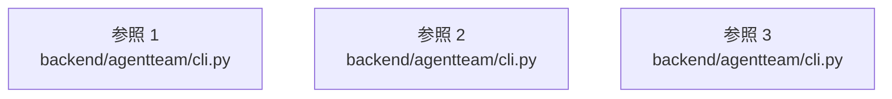

# dependency-map/group-1/n-backend-agentteam-cli-py-3dd889

[解析トップへ戻る](../../../README.md)

確認済みファイル: `backend/agentteam/cli.py`

解析: Python AST。静的なimport／export参照です。関数の実行順序やHTTP通信は表していません。

宣言: `main`, `_probe_hint`, `_probe`, `_run`, `_quickstart`

- `__future__` → 外部・標準ライブラリ・別名など。ローカル対応先は未確定
- `argparse` → 外部・標準ライブラリ・別名など。ローカル対応先は未確定
- `asyncio` → 外部・標準ライブラリ・別名など。ローカル対応先は未確定
- `json` → 外部・標準ライブラリ・別名など。ローカル対応先は未確定
- `sys` → 外部・標準ライブラリ・別名など。ローカル対応先は未確定
- `pathlib` → 外部・標準ライブラリ・別名など。ローカル対応先は未確定
- `api.service` → `backend/agentteam/api/service.py`（一覧確認・内容未読）
- `config.loader` → `backend/agentteam/config/loader.py`（一覧確認・内容未読）
- `contracts` → `backend/agentteam/contracts.py`（内容確認済み）
- `providers.registry` → `backend/agentteam/providers/registry.py`（内容確認済み）
- `shutil` → 外部・標準ライブラリ・別名など。ローカル対応先は未確定
- `threading` → 外部・標準ライブラリ・別名など。ローカル対応先は未確定
- `webbrowser` → 外部・標準ライブラリ・別名など。ローカル対応先は未確定
- `uvicorn` → 外部・標準ライブラリ・別名など。ローカル対応先は未確定
- `api.app` → `backend/agentteam/api/app.py`（内容確認済み）
- `time` → 外部・標準ライブラリ・別名など。ローカル対応先は未確定
- `operations.observer` → `backend/agentteam/operations/observer.py`（一覧確認・内容未読）
- `operations.encrypted_backup` → `backend/agentteam/operations/encrypted_backup.py`（一覧確認・内容未読）
- `operations.retention` → `backend/agentteam/operations/retention.py`（一覧確認・内容未読）
- `security.accounts` → `backend/agentteam/security/accounts.py`（一覧確認・内容未読）
- `operations.backup` → `backend/agentteam/operations/backup.py`（一覧確認・内容未読）
- `providers.base` → `backend/agentteam/providers/base.py`（一覧確認・内容未読）

## 要素の説明

### imports-1

import参照の表示用グループ。

[詳細な図と説明を見る](imports-1/README.md)

### imports-2

import参照の表示用グループ。

[詳細な図と説明を見る](imports-2/README.md)

### imports-3

import参照の表示用グループ。

[詳細な図と説明を見る](imports-3/README.md)

