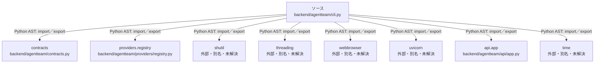

# dependency-map/group-1/n-backend-agentteam-cli-py-3dd889/imports-2

[解析トップへ戻る](../../../../README.md)

import参照の表示用グループ。

## 要素の説明

### n-api-app-6de14d

参照名: `api.app`

対応する実在ソース: `backend/agentteam/api/app.py`。内容確認済み。

### n-contracts-80cff8

参照名: `contracts`

対応する実在ソース: `backend/agentteam/contracts.py`。内容確認済み。

### n-providers-registry-8a1917

参照名: `providers.registry`

対応する実在ソース: `backend/agentteam/providers/registry.py`。内容確認済み。

### n-shutil-748708

参照名: `shutil`

ローカルのソース対応先を確定できませんでした。外部ライブラリ、標準ライブラリ、型別名などを区別する追加確認が必要です。

### n-threading-c3015a

参照名: `threading`

ローカルのソース対応先を確定できませんでした。外部ライブラリ、標準ライブラリ、型別名などを区別する追加確認が必要です。

### n-time-714eea

参照名: `time`

ローカルのソース対応先を確定できませんでした。外部ライブラリ、標準ライブラリ、型別名などを区別する追加確認が必要です。

### n-uvicorn-c0aa57

参照名: `uvicorn`

ローカルのソース対応先を確定できませんでした。外部ライブラリ、標準ライブラリ、型別名などを区別する追加確認が必要です。

### n-webbrowser-decbbb

参照名: `webbrowser`

ローカルのソース対応先を確定できませんでした。外部ライブラリ、標準ライブラリ、型別名などを区別する追加確認が必要です。

### source

`backend/agentteam/cli.py` の内容を確認しました。

