# dependency-map/group-1/n-backend-agentteam-cli-py-3dd889/imports-3

[解析トップへ戻る](../../../../README.md)

import参照の表示用グループ。

```mermaid
graph TD
    source["ソース\nbackend/agentteam/cli.py"]
    n-operations-observer-b65876["operations.observer\nbackend/agentteam/operations/observer.py"]
    source -->|"Python AST: import／export"| n-operations-observer-b65876
    n-operations-encrypted-backup-47f6b6["operations.encrypted_backup\nbackend/agentteam/operations/encrypted_backup.py"]
    source -->|"Python AST: import／export"| n-operations-encrypted-backup-47f6b6
    n-operations-retention-b1dce5["operations.retention\nbackend/agentteam/operations/retention.py"]
    source -->|"Python AST: import／export"| n-operations-retention-b1dce5
    n-security-accounts-f5c7f9["security.accounts\nbackend/agentteam/security/accounts.py"]
    source -->|"Python AST: import／export"| n-security-accounts-f5c7f9
    n-operations-backup-7a4121["operations.backup\nbackend/agentteam/operations/backup.py"]
    source -->|"Python AST: import／export"| n-operations-backup-7a4121
    n-providers-base-69daea["providers.base\nbackend/agentteam/providers/base.py"]
    source -->|"Python AST: import／export"| n-providers-base-69daea
```

## 要素の説明

### n-operations-backup-7a4121

参照名: `operations.backup`

対応する実在ソース: `backend/agentteam/operations/backup.py`。内容は未読。

### n-operations-encrypted-backup-47f6b6

参照名: `operations.encrypted_backup`

対応する実在ソース: `backend/agentteam/operations/encrypted_backup.py`。内容は未読。

### n-operations-observer-b65876

参照名: `operations.observer`

対応する実在ソース: `backend/agentteam/operations/observer.py`。内容は未読。

### n-operations-retention-b1dce5

参照名: `operations.retention`

対応する実在ソース: `backend/agentteam/operations/retention.py`。内容は未読。

### n-providers-base-69daea

参照名: `providers.base`

対応する実在ソース: `backend/agentteam/providers/base.py`。内容は未読。

### n-security-accounts-f5c7f9

参照名: `security.accounts`

対応する実在ソース: `backend/agentteam/security/accounts.py`。内容は未読。

### source

`backend/agentteam/cli.py` の内容を確認しました。

