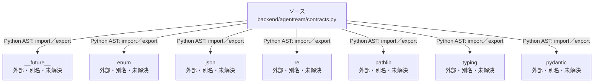

# dependency-map/group-1/n-backend-agentteam-contracts-py-c82b22

[解析トップへ戻る](../../../README.md)

確認済みファイル: `backend/agentteam/contracts.py`

解析: Python AST。静的なimport／export参照です。関数の実行順序やHTTP通信は表していません。

宣言: `is_readiness_assessment`, `task_id_problem`, `ArtifactRef`, `AcceptanceCriterion`, `TaskSpec`, `TeamPlan`, `TaskStatus`, `RunStatus`, `EventType`, `Event`, `Message`, `ArtifactManifest`, `ApprovalStatus`, `Approval`, `ReviewResult`, `Review`, `TaskResult`, `Usage`, `TaskState`, `DeliveryRequirement`, `RunInputs`, `Run`

- `__future__` → 外部・標準ライブラリ・別名など。ローカル対応先は未確定
- `enum` → 外部・標準ライブラリ・別名など。ローカル対応先は未確定
- `json` → 外部・標準ライブラリ・別名など。ローカル対応先は未確定
- `re` → 外部・標準ライブラリ・別名など。ローカル対応先は未確定
- `pathlib` → 外部・標準ライブラリ・別名など。ローカル対応先は未確定
- `typing` → 外部・標準ライブラリ・別名など。ローカル対応先は未確定
- `pydantic` → 外部・標準ライブラリ・別名など。ローカル対応先は未確定

## 要素の説明

### n-enum-e338e8

参照名: `enum`

ローカルのソース対応先を確定できませんでした。外部ライブラリ、標準ライブラリ、型別名などを区別する追加確認が必要です。

### n-future-05a733

参照名: `__future__`

ローカルのソース対応先を確定できませんでした。外部ライブラリ、標準ライブラリ、型別名などを区別する追加確認が必要です。

### n-json-05d97e

参照名: `json`

ローカルのソース対応先を確定できませんでした。外部ライブラリ、標準ライブラリ、型別名などを区別する追加確認が必要です。

### n-pathlib-4471f7

参照名: `pathlib`

ローカルのソース対応先を確定できませんでした。外部ライブラリ、標準ライブラリ、型別名などを区別する追加確認が必要です。

### n-pydantic-196fee

参照名: `pydantic`

ローカルのソース対応先を確定できませんでした。外部ライブラリ、標準ライブラリ、型別名などを区別する追加確認が必要です。

### n-re-c387c9

参照名: `re`

ローカルのソース対応先を確定できませんでした。外部ライブラリ、標準ライブラリ、型別名などを区別する追加確認が必要です。

### n-typing-02d7d3

参照名: `typing`

ローカルのソース対応先を確定できませんでした。外部ライブラリ、標準ライブラリ、型別名などを区別する追加確認が必要です。

### source

`backend/agentteam/contracts.py` の内容を確認しました。

