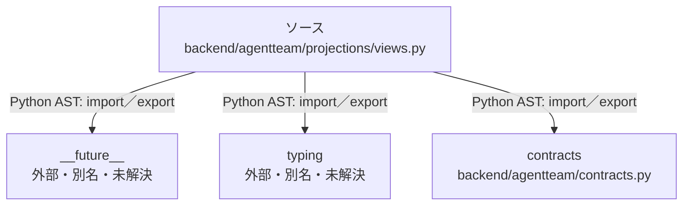

# dependency-map/group-1/n-backend-agentteam-projections-views-py-dd7796

[解析トップへ戻る](../../../README.md)

確認済みファイル: `backend/agentteam/projections/views.py`

解析: Python AST。静的なimport／export参照です。関数の実行順序やHTTP通信は表していません。

宣言: `chat_view`, `timeline_view`, `artifact_review_ledger`, `evidence_view`, `_count`

- `__future__` → 外部・標準ライブラリ・別名など。ローカル対応先は未確定
- `typing` → 外部・標準ライブラリ・別名など。ローカル対応先は未確定
- `contracts` → `backend/agentteam/contracts.py`（内容確認済み）

## 要素の説明

### n-contracts-80cff8

参照名: `contracts`

対応する実在ソース: `backend/agentteam/contracts.py`。内容確認済み。

### n-future-05a733

参照名: `__future__`

ローカルのソース対応先を確定できませんでした。外部ライブラリ、標準ライブラリ、型別名などを区別する追加確認が必要です。

### n-typing-02d7d3

参照名: `typing`

ローカルのソース対応先を確定できませんでした。外部ライブラリ、標準ライブラリ、型別名などを区別する追加確認が必要です。

### source

`backend/agentteam/projections/views.py` の内容を確認しました。

