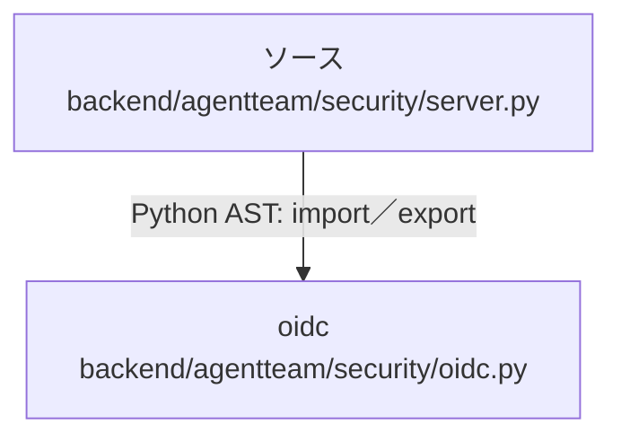

# dependency-map/group-1/n-backend-agentteam-security-server-py-3b0154/imports-2

[解析トップへ戻る](../../../../README.md)

import参照の表示用グループ。

## 要素の説明

### n-oidc-9ee859

参照名: `oidc`

対応する実在ソース: `backend/agentteam/security/oidc.py`。内容は未読。

### source

`backend/agentteam/security/server.py` の内容を確認しました。

