# dependency-map/group-1/n-frontend-src-app-tsx-b9c538/imports-1

[解析トップへ戻る](../../../../README.md)

import参照の表示用グループ。

```mermaid
graph TD
    source["ソース\nfrontend/src/App.tsx"]
    n-lib-i18n-637fd1["./lib/i18n\nfrontend/src/lib/i18n.ts"]
    source -->|"字句抽出: import／export"| n-lib-i18n-637fd1
    n-react-6b810c["react\n外部・別名・未解決"]
    source -->|"字句抽出: import／export"| n-react-6b810c
    n-lib-api-eea930["./lib/api\nfrontend/src/lib/api.ts"]
    source -->|"字句抽出: import／export"| n-lib-api-eea930
    n-lib-router-97c7d8["./lib/router\nfrontend/src/lib/router.tsx"]
    source -->|"字句抽出: import／export"| n-lib-router-97c7d8
    n-pages-home-59d2cc["./pages/Home\nfrontend/src/pages/Home.tsx"]
    source -->|"字句抽出: import／export"| n-pages-home-59d2cc
    n-pages-worklist-1e41b1["./pages/WorkList\nfrontend/src/pages/WorkList.tsx"]
    source -->|"字句抽出: import／export"| n-pages-worklist-1e41b1
    n-pages-workroom-e7fd3b["./pages/Workroom\nfrontend/src/pages/Workroom.tsx"]
    source -->|"字句抽出: import／export"| n-pages-workroom-e7fd3b
    n-pages-settings-25ceae["./pages/Settings\nfrontend/src/pages/Settings.tsx"]
    source -->|"字句抽出: import／export"| n-pages-settings-25ceae
```

## 要素の説明

### n-lib-api-eea930

参照名: `./lib/api`

対応する実在ソース: `frontend/src/lib/api.ts`。内容は未読。

### n-lib-i18n-637fd1

参照名: `./lib/i18n`

対応する実在ソース: `frontend/src/lib/i18n.ts`。内容は未読。

### n-lib-router-97c7d8

参照名: `./lib/router`

対応する実在ソース: `frontend/src/lib/router.tsx`。内容は未読。

### n-pages-home-59d2cc

参照名: `./pages/Home`

対応する実在ソース: `frontend/src/pages/Home.tsx`。内容は未読。

### n-pages-settings-25ceae

参照名: `./pages/Settings`

対応する実在ソース: `frontend/src/pages/Settings.tsx`。内容は未読。

### n-pages-worklist-1e41b1

参照名: `./pages/WorkList`

対応する実在ソース: `frontend/src/pages/WorkList.tsx`。内容は未読。

### n-pages-workroom-e7fd3b

参照名: `./pages/Workroom`

対応する実在ソース: `frontend/src/pages/Workroom.tsx`。内容は未読。

### n-react-6b810c

参照名: `react`

ローカルのソース対応先を確定できませんでした。外部ライブラリ、標準ライブラリ、型別名などを区別する追加確認が必要です。

### source

`frontend/src/App.tsx` の内容を確認しました。

