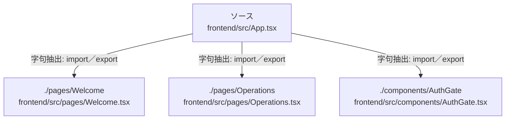

# dependency-map/group-1/n-frontend-src-app-tsx-b9c538/imports-2

[解析トップへ戻る](../../../../README.md)

import参照の表示用グループ。

## 要素の説明

### n-components-authgate-08be9e

参照名: `./components/AuthGate`

対応する実在ソース: `frontend/src/components/AuthGate.tsx`。内容は未読。

### n-pages-operations-f17d3d

参照名: `./pages/Operations`

対応する実在ソース: `frontend/src/pages/Operations.tsx`。内容は未読。

### n-pages-welcome-83f8db

参照名: `./pages/Welcome`

対応する実在ソース: `frontend/src/pages/Welcome.tsx`。内容は未読。

### source

`frontend/src/App.tsx` の内容を確認しました。

