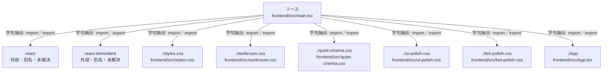

# dependency-map/group-1/n-frontend-src-main-tsx-d34671/imports-1

[解析トップへ戻る](../../../../README.md)

import参照の表示用グループ。

## 要素の説明

### n-app-4c727b

参照名: `./App`

対応する実在ソース: `frontend/src/App.tsx`。内容確認済み。

### n-bot-polish-css-854a32

参照名: `./bot-polish.css`

対応する実在ソース: `frontend/src/bot-polish.css`。内容確認済み。

### n-quiet-cinema-css-117f7f

参照名: `./quiet-cinema.css`

対応する実在ソース: `frontend/src/quiet-cinema.css`。内容確認済み。

### n-react-6b810c

参照名: `react`

ローカルのソース対応先を確定できませんでした。外部ライブラリ、標準ライブラリ、型別名などを区別する追加確認が必要です。

### n-react-dom-client-bcbcc9

参照名: `react-dom/client`

ローカルのソース対応先を確定できませんでした。外部ライブラリ、標準ライブラリ、型別名などを区別する追加確認が必要です。

### n-styles-css-df4e47

参照名: `./styles.css`

対応する実在ソース: `frontend/src/styles.css`。内容確認済み。

### n-ui-polish-css-8985f6

参照名: `./ui-polish.css`

対応する実在ソース: `frontend/src/ui-polish.css`。内容確認済み。

### n-workroom-css-f05ae5

参照名: `./workroom.css`

対応する実在ソース: `frontend/src/workroom.css`。内容確認済み。

### source

`frontend/src/main.tsx` の内容を確認しました。

