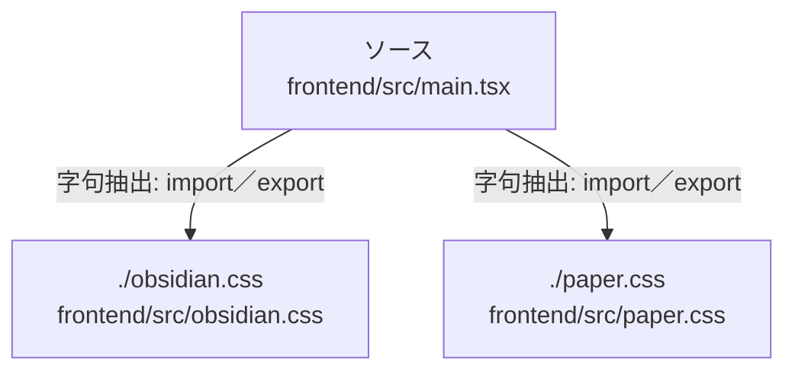

# dependency-map/group-1/n-frontend-src-main-tsx-d34671/imports-2

[解析トップへ戻る](../../../../README.md)

import参照の表示用グループ。

## 要素の説明

### n-obsidian-css-d841e9

参照名: `./obsidian.css`

対応する実在ソース: `frontend/src/obsidian.css`。内容確認済み。

### n-paper-css-1171e8

参照名: `./paper.css`

対応する実在ソース: `frontend/src/paper.css`。内容確認済み。

### source

`frontend/src/main.tsx` の内容を確認しました。

