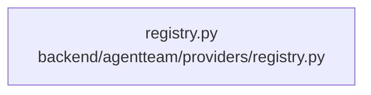

# dependency-map/group-2

[解析トップへ戻る](../../README.md)

このグループは表示用の区切りです。独立した実行モジュールではありません。

## 要素の説明

### n-backend-agentteam-providers-registry-py-d287b0

確認済みファイル: `backend/agentteam/providers/registry.py`

解析: Python AST。静的なimport／export参照です。関数の実行順序やHTTP通信は表していません。

宣言: `ProviderRegistry`

- `__future__` → 外部・標準ライブラリ・別名など。ローカル対応先は未確定
- `os` → 外部・標準ライブラリ・別名など。ローカル対応先は未確定
- `typing` → 外部・標準ライブラリ・別名など。ローカル対応先は未確定
- `config.models` → `backend/agentteam/config/models.py`（一覧確認・内容未読）
- `config.secrets` → `backend/agentteam/config/secrets.py`（一覧確認・内容未読）
- `anthropic_driver` → `backend/agentteam/providers/anthropic_driver.py`（一覧確認・内容未読）
- `base` → `backend/agentteam/providers/base.py`（一覧確認・内容未読）
- `claude_cli_driver` → `backend/agentteam/providers/claude_cli_driver.py`（一覧確認・内容未読）
- `openai_compat_driver` → `backend/agentteam/providers/openai_compat_driver.py`（一覧確認・内容未読）

[詳細な図と説明を見る](n-backend-agentteam-providers-registry-py-d287b0/README.md)

