# dependency-map/group-2/n-backend-agentteam-providers-registry-py-d287b0/imports-1

[解析トップへ戻る](../../../../README.md)

import参照の表示用グループ。

```mermaid
graph TD
    source["ソース\nbackend/agentteam/providers/registry.py"]
    n-future-05a733["__future__\n外部・別名・未解決"]
    source -->|"Python AST: import／export"| n-future-05a733
    n-os-999a34["os\n外部・別名・未解決"]
    source -->|"Python AST: import／export"| n-os-999a34
    n-typing-02d7d3["typing\n外部・別名・未解決"]
    source -->|"Python AST: import／export"| n-typing-02d7d3
    n-config-models-3c5fce["config.models\nbackend/agentteam/config/models.py"]
    source -->|"Python AST: import／export"| n-config-models-3c5fce
    n-config-secrets-076797["config.secrets\nbackend/agentteam/config/secrets.py"]
    source -->|"Python AST: import／export"| n-config-secrets-076797
    n-anthropic-driver-2c483f["anthropic_driver\nbackend/agentteam/providers/anthropic_driver.py"]
    source -->|"Python AST: import／export"| n-anthropic-driver-2c483f
    n-base-1405df["base\nbackend/agentteam/providers/base.py"]
    source -->|"Python AST: import／export"| n-base-1405df
    n-claude-cli-driver-f123a6["claude_cli_driver\nbackend/agentteam/providers/claude_cli_driver.py"]
    source -->|"Python AST: import／export"| n-claude-cli-driver-f123a6
```

## 要素の説明

### n-anthropic-driver-2c483f

参照名: `anthropic_driver`

対応する実在ソース: `backend/agentteam/providers/anthropic_driver.py`。内容は未読。

### n-base-1405df

参照名: `base`

対応する実在ソース: `backend/agentteam/providers/base.py`。内容は未読。

### n-claude-cli-driver-f123a6

参照名: `claude_cli_driver`

対応する実在ソース: `backend/agentteam/providers/claude_cli_driver.py`。内容は未読。

### n-config-models-3c5fce

参照名: `config.models`

対応する実在ソース: `backend/agentteam/config/models.py`。内容は未読。

### n-config-secrets-076797

参照名: `config.secrets`

対応する実在ソース: `backend/agentteam/config/secrets.py`。内容は未読。

### n-future-05a733

参照名: `__future__`

ローカルのソース対応先を確定できませんでした。外部ライブラリ、標準ライブラリ、型別名などを区別する追加確認が必要です。

### n-os-999a34

参照名: `os`

ローカルのソース対応先を確定できませんでした。外部ライブラリ、標準ライブラリ、型別名などを区別する追加確認が必要です。

### n-typing-02d7d3

参照名: `typing`

ローカルのソース対応先を確定できませんでした。外部ライブラリ、標準ライブラリ、型別名などを区別する追加確認が必要です。

### source

`backend/agentteam/providers/registry.py` の内容を確認しました。

