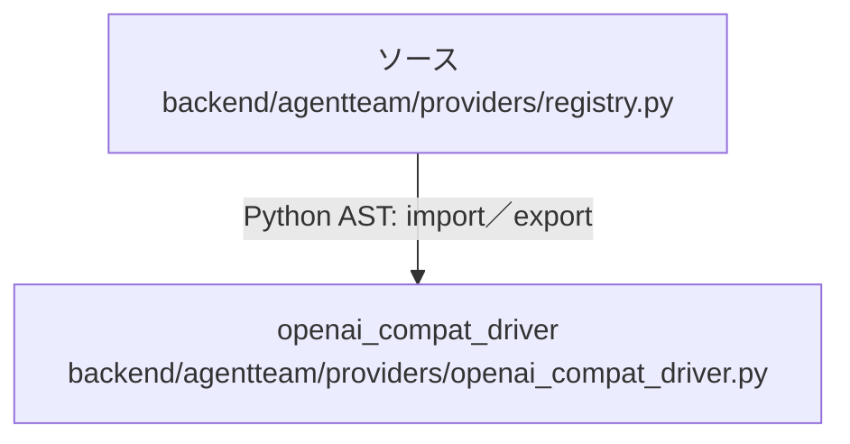

# dependency-map/group-2/n-backend-agentteam-providers-registry-py-d287b0/imports-2

[解析トップへ戻る](../../../../README.md)

import参照の表示用グループ。

## 要素の説明

### n-openai-compat-driver-9ab042

参照名: `openai_compat_driver`

対応する実在ソース: `backend/agentteam/providers/openai_compat_driver.py`。内容は未読。

### source

`backend/agentteam/providers/registry.py` の内容を確認しました。

