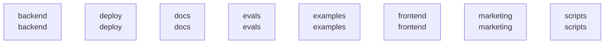

# overall-architecture

[解析トップへ戻る](../README.md)

# Multibot

Agent TeamのPythonバックエンド、React UI、CLIとセキュリティ層。

この図はリポジトリ内の構成です。コードを実行した結果やサービス間の通信保証ではありません。

## 対象と根拠

対象: https://github.com/FORIFOR/Multibot

取得ブランチ: `main`

Git tree SHA: `e1d03c7ebe9c42bbaec604441926b9df5112c9d2`

ファイル一覧: 1287件。内容確認: 19件。全ファイルの意味解析ではありません。

## 解析の制約

実コードの取得は入口、マニフェスト、直接参照先を中心とする初回解析です。動的ロード、実行時設定、別リポジトリとの接続、ローカル未コミット変更は未確認です。

## 確認が必要な点

構成図の配置関係と、実際の通信・呼び出し関係を区別してください。README上の機能や精度の記述は動作検証済みという意味ではありません。

## 追加解析

未読の中核モジュールから処理順序・データ保存・状態遷移を追加解析する。実行環境で通信先と機能フラグを照合する。

## 補足

2026-10-11の初回解析スナップショットです。現在のコードとの差分や実行環境は追加確認が必要です。

## 要素の説明

### n-backend-754a08

確認したパス: `backend`。配下の登録ファイルは147件。

- `backend/agentteam/__init__.py`（一覧のみ）
- `backend/agentteam/api/__init__.py`（一覧のみ）
- `backend/agentteam/api/app.py`（内容確認済み）
- `backend/agentteam/api/service.py`（一覧のみ）
- `backend/agentteam/cli.py`（内容確認済み）
- `backend/agentteam/config/__init__.py`（一覧のみ）
- `backend/agentteam/config/loader.py`（一覧のみ）
- `backend/agentteam/config/models.py`（一覧のみ）
- `backend/agentteam/config/secrets.py`（一覧のみ）
- `backend/agentteam/config/voice.py`（一覧のみ）
- `backend/agentteam/contracts.py`（内容確認済み）
- `backend/agentteam/demo.py`（一覧のみ）
- `backend/agentteam/demo_command.py`（一覧のみ）
- `backend/agentteam/ids.py`（内容確認済み）
- `backend/agentteam/operations/__init__.py`（一覧のみ）
- `backend/agentteam/operations/backup.py`（一覧のみ）
- `backend/agentteam/operations/encrypted_backup.py`（一覧のみ）
- `backend/agentteam/operations/observer.py`（一覧のみ）
- `backend/agentteam/operations/retention.py`（一覧のみ）
- `backend/agentteam/projections/__init__.py`（一覧のみ）
- `backend/agentteam/projections/views.py`（内容確認済み）
- `backend/agentteam/prompts/builder.md`（一覧のみ）
- `backend/agentteam/prompts/master.md`（一覧のみ）
- `backend/agentteam/prompts/platform-policy.md`（一覧のみ）
- `backend/agentteam/prompts/readiness-series.md`（一覧のみ）
- `backend/agentteam/prompts/reporter.md`（一覧のみ）
- `backend/agentteam/prompts/researcher.md`（一覧のみ）
- `backend/agentteam/prompts/reviewer.md`（一覧のみ）
- `backend/agentteam/prompts/team-compiler.md`（一覧のみ）
- `backend/agentteam/prompts/worker.md`（一覧のみ）
- `backend/agentteam/providers/__init__.py`（一覧のみ）
- `backend/agentteam/providers/anthropic_driver.py`（一覧のみ）
- `backend/agentteam/providers/base.py`（一覧のみ）
- `backend/agentteam/providers/claude_cli_driver.py`（一覧のみ）
- `backend/agentteam/providers/claude_cli_mcp.py`（一覧のみ）

[詳細な図と説明を見る](n-backend-754a08/README.md)

### n-deploy-b0d51b

確認したパス: `deploy`。配下の登録ファイルは2件。

- `deploy/agentteam-observer.service`（一覧のみ）
- `deploy/compose.yaml`（一覧のみ）

### n-docs-71ab8b

確認したパス: `docs`。配下の登録ファイルは955件。

- `docs/DATA_OPERATIONS.md`（一覧のみ）
- `docs/DELIVERY_REQUIREMENTS.md`（一覧のみ）
- `docs/DURABLE_EXECUTION.md`（一覧のみ）
- `docs/ENTERPRISE_READINESS.md`（一覧のみ）
- `docs/IMPLEMENTATION_PLAN.md`（一覧のみ）
- `docs/OPERATIONS.md`（一覧のみ）
- `docs/PRODUCTION.md`（一覧のみ）
- `docs/PRODUCTION_PLAN.md`（一覧のみ）
- `docs/REACHMADE_MIGRATION.md`（一覧のみ）
- `docs/REAL_WORKFLOW_ACCEPTANCE.md`（一覧のみ）
- `docs/RELEASE_OPERATIONS.md`（一覧のみ）
- `docs/SSO.md`（一覧のみ）
- `docs/STATUS.md`（一覧のみ）
- `docs/WORKPLACE_BENCHMARK.md`（一覧のみ）
- `docs/blueprint/IMPLEMENTATION_BRIEF.md`（一覧のみ）
- `docs/blueprint/PRODUCT_SPEC.md`（一覧のみ）
- `docs/blueprint/README.md`（一覧のみ）
- `docs/blueprint/REFERENCES.md`（一覧のみ）
- `docs/blueprint/SECURITY.md`（一覧のみ）
- `docs/blueprint/reference-registry.json`（一覧のみ）
- `docs/config/Modelfile.qwen35-9b`（一覧のみ）
- `docs/config/cost-optimized.yaml`（一覧のみ）
- `docs/config/local-qwen25-7b-single.yaml`（一覧のみ）
- `docs/config/local-qwen25-7b-team.yaml`（一覧のみ）
- `docs/config/local-qwen35-9b-single.yaml`（一覧のみ）
- `docs/config/local-qwen35-9b-team.yaml`（一覧のみ）
- `docs/config/local-qwen35-9b-thinking-single.yaml`（一覧のみ）
- `docs/config/local-qwen35-9b-thinking-team.yaml`（一覧のみ）
- `docs/config/single-agent.yaml`（一覧のみ）
- `docs/design/acceptance.md`（一覧のみ）
- `docs/design/brief.md`（一覧のみ）
- `docs/design/references/README.md`（一覧のみ）
- `docs/design/report-template.md`（一覧のみ）
- `docs/design/tokens.md`（一覧のみ）
- `docs/evidence/adaptive-team-2026-09-20/architecture-r1.md`（一覧のみ）

[詳細な図と説明を見る](n-docs-71ab8b/README.md)

### n-evals-64bacb

確認したパス: `evals`。配下の登録ファイルは5件。

- `evals/ACCEPTANCE.md`（一覧のみ）
- `evals/RESULTS.md`（一覧のみ）
- `evals/benchmark/tasks.py`（一覧のみ）
- `evals/cases.jsonl`（一覧のみ）
- `evals/workplace_benchmark.py`（一覧のみ）

[詳細な図と説明を見る](n-evals-64bacb/README.md)

### n-examples-99345c

確認したパス: `examples`。配下の登録ファイルは1件。

- `examples/http_client.py`（一覧のみ）

### n-frontend-9ecc84

確認したパス: `frontend`。配下の登録ファイルは123件。

- `frontend/.gitignore`（一覧のみ）
- `frontend/.oxlintrc.json`（一覧のみ）
- `frontend/index.html`（一覧のみ）
- `frontend/package.json`（内容確認済み）
- `frontend/pnpm-lock.yaml`（一覧のみ）
- `frontend/public/favicon.svg`（一覧のみ）
- `frontend/public/icons.svg`（一覧のみ）
- `frontend/scripts/a11y-smoke.mjs`（一覧のみ）
- `frontend/scripts/adaptive-team-start.mjs`（一覧のみ）
- `frontend/scripts/ask-capture.mjs`（一覧のみ）
- `frontend/scripts/capture-ui-references.mjs`（一覧のみ）
- `frontend/scripts/comparative-ui-check.mjs`（一覧のみ）
- `frontend/scripts/completion-conditions-check.mjs`（一覧のみ）
- `frontend/scripts/completion-download.mjs`（一覧のみ）
- `frontend/scripts/completion-final-request.mjs`（一覧のみ）
- `frontend/scripts/completion-original-request.mjs`（一覧のみ）
- `frontend/scripts/completion-request.mjs`（一覧のみ）
- `frontend/scripts/completion-start.mjs`（一覧のみ）
- `frontend/scripts/completion-storage-check.mjs`（一覧のみ）
- `frontend/scripts/completion-storage-volume-check.mjs`（一覧のみ）
- `frontend/scripts/conversation-processing-check.mjs`（一覧のみ）
- `frontend/scripts/creation-studio-check.mjs`（一覧のみ）
- `frontend/scripts/demo-source.md`（一覧のみ）
- `frontend/scripts/durable-browser-smoke.mjs`（一覧のみ）
- `frontend/scripts/edit-demo.mjs`（一覧のみ）
- `frontend/scripts/elapsed-check.mjs`（一覧のみ）
- `frontend/scripts/emoji-icons-check.mjs`（一覧のみ）
- `frontend/scripts/journey-capture.mjs`（一覧のみ）
- `frontend/scripts/make-captions.mjs`（一覧のみ）
- `frontend/scripts/make-og.mjs`（一覧のみ）
- `frontend/scripts/motion-check.mjs`（一覧のみ）
- `frontend/scripts/oidc-smoke.mjs`（一覧のみ）
- `frontend/scripts/product-quality-cancel.mjs`（一覧のみ）
- `frontend/scripts/product-quality-draft.mjs`（一覧のみ）
- `frontend/scripts/product-quality-live.mjs`（一覧のみ）

[詳細な図と説明を見る](n-frontend-9ecc84/README.md)

### n-marketing-a28607

確認したパス: `marketing`。配下の登録ファイルは12件。

- `marketing/LAUNCH.md`（一覧のみ）
- `marketing/POSTED.md`（一覧のみ）
- `marketing/RESEARCH-2026-09-14.md`（一覧のみ）
- `marketing/VALIDATION-2026-09-14.md`（一覧のみ）
- `marketing/ZENN-RESEARCH-2026-09-14.md`（一覧のみ）
- `marketing/audit-2026-09-14/accounts.csv`（一覧のみ）
- `marketing/audit-2026-09-14/activities.csv`（一覧のみ）
- `marketing/audit-2026-09-14/assets.csv`（一覧のみ）
- `marketing/audit-2026-09-14/metrics.csv`（一覧のみ）
- `marketing/audit-2026-09-14/status-audit.md`（一覧のみ）
- `marketing/devto-agent-team-launch.md`（一覧のみ）
- `marketing/post_x.py`（一覧のみ）

[詳細な図と説明を見る](n-marketing-a28607/README.md)

### n-scripts-16728d

確認したパス: `scripts`。配下の登録ファイルは8件。

- `scripts/tests/ui-gate.test.mjs`（一覧のみ）
- `scripts/ui-quality.mjs`（一覧のみ）
- `scripts/ui-stop-gate.mjs`（一覧のみ）
- `scripts/video/build-intro.sh`（一覧のみ）
- `scripts/video/build-real-walkthrough.sh`（一覧のみ）
- `scripts/video/narration.txt`（一覧のみ）
- `scripts/video/real-walkthrough-ja.txt`（一覧のみ）
- `scripts/video/scenes.html`（一覧のみ）

[詳細な図と説明を見る](n-scripts-16728d/README.md)

