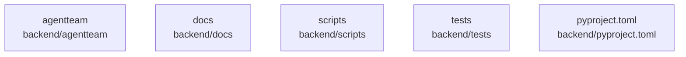

# overall-architecture/n-backend-754a08

[解析トップへ戻る](../../README.md)

確認したパス: `backend`。配下の登録ファイルは147件。

- `backend/agentteam/__init__.py`（一覧のみ）
- `backend/agentteam/api/__init__.py`（一覧のみ）
- `backend/agentteam/api/app.py`（内容確認済み）
- `backend/agentteam/api/service.py`（一覧のみ）
- `backend/agentteam/cli.py`（内容確認済み）
- `backend/agentteam/config/__init__.py`（一覧のみ）
- `backend/agentteam/config/loader.py`（一覧のみ）
- `backend/agentteam/config/models.py`（一覧のみ）
- `backend/agentteam/config/secrets.py`（一覧のみ）
- `backend/agentteam/config/voice.py`（一覧のみ）
- `backend/agentteam/contracts.py`（内容確認済み）
- `backend/agentteam/demo.py`（一覧のみ）
- `backend/agentteam/demo_command.py`（一覧のみ）
- `backend/agentteam/ids.py`（内容確認済み）
- `backend/agentteam/operations/__init__.py`（一覧のみ）
- `backend/agentteam/operations/backup.py`（一覧のみ）
- `backend/agentteam/operations/encrypted_backup.py`（一覧のみ）
- `backend/agentteam/operations/observer.py`（一覧のみ）
- `backend/agentteam/operations/retention.py`（一覧のみ）
- `backend/agentteam/projections/__init__.py`（一覧のみ）
- `backend/agentteam/projections/views.py`（内容確認済み）
- `backend/agentteam/prompts/builder.md`（一覧のみ）
- `backend/agentteam/prompts/master.md`（一覧のみ）
- `backend/agentteam/prompts/platform-policy.md`（一覧のみ）
- `backend/agentteam/prompts/readiness-series.md`（一覧のみ）
- `backend/agentteam/prompts/reporter.md`（一覧のみ）
- `backend/agentteam/prompts/researcher.md`（一覧のみ）
- `backend/agentteam/prompts/reviewer.md`（一覧のみ）
- `backend/agentteam/prompts/team-compiler.md`（一覧のみ）
- `backend/agentteam/prompts/worker.md`（一覧のみ）
- `backend/agentteam/providers/__init__.py`（一覧のみ）
- `backend/agentteam/providers/anthropic_driver.py`（一覧のみ）
- `backend/agentteam/providers/base.py`（一覧のみ）
- `backend/agentteam/providers/claude_cli_driver.py`（一覧のみ）
- `backend/agentteam/providers/claude_cli_mcp.py`（一覧のみ）

## 要素の説明

### n-backend-agentteam-6c4c2f

実在パス: `backend/agentteam`。80ファイル。

- `backend/agentteam/__init__.py`
- `backend/agentteam/api/__init__.py`
- `backend/agentteam/api/app.py`
- `backend/agentteam/api/service.py`
- `backend/agentteam/cli.py`
- `backend/agentteam/config/__init__.py`
- `backend/agentteam/config/loader.py`
- `backend/agentteam/config/models.py`
- `backend/agentteam/config/secrets.py`
- `backend/agentteam/config/voice.py`
- `backend/agentteam/contracts.py`
- `backend/agentteam/demo.py`
- `backend/agentteam/demo_command.py`
- `backend/agentteam/ids.py`
- `backend/agentteam/operations/__init__.py`
- `backend/agentteam/operations/backup.py`
- `backend/agentteam/operations/encrypted_backup.py`
- `backend/agentteam/operations/observer.py`
- `backend/agentteam/operations/retention.py`
- `backend/agentteam/projections/__init__.py`
- `backend/agentteam/projections/views.py`
- `backend/agentteam/prompts/builder.md`
- `backend/agentteam/prompts/master.md`
- `backend/agentteam/prompts/platform-policy.md`
- `backend/agentteam/prompts/readiness-series.md`

### n-backend-docs-2e3311

実在パス: `backend/docs`。8ファイル。

- `backend/docs/evidence/scenarios/research2/deer-flow-supplement.md.r1`
- `backend/docs/evidence/scenarios/research2/events.jsonl`
- `backend/docs/evidence/scenarios/research2/final-report.md.r1`
- `backend/docs/evidence/scenarios/research2/research-final-r2.md.r1`
- `backend/docs/evidence/scenarios/research2/research.md.r1`
- `backend/docs/evidence/scenarios/research2/review-final.md.r1`
- `backend/docs/evidence/scenarios/research2/review.md.r1`
- `backend/docs/evidence/scenarios/results-research-rerun.jsonl`

### n-backend-pyproject-toml-4ac4d2

実在パス: `backend/pyproject.toml`。1ファイル。

- `backend/pyproject.toml`

### n-backend-scripts-56d392

実在パス: `backend/scripts`。19ファイル。

- `backend/scripts/benchmark.py`
- `backend/scripts/check_durable_local.py`
- `backend/scripts/check_oidc_restore.py`
- `backend/scripts/check_release_upgrade.py`
- `backend/scripts/check_research_fetch.py`
- `backend/scripts/check_secure_server.py`
- `backend/scripts/demo_fake_server.py`
- `backend/scripts/eval_scenarios.py`
- `backend/scripts/local_benchmark_campaign.py`
- `backend/scripts/production_workflow.py`
- `backend/scripts/provision_oidc_staging.py`
- `backend/scripts/provision_secure_smoke.py`
- `backend/scripts/reviewer_catch_rate.py`
- `backend/scripts/serve_recorded_quality.py`
- `backend/scripts/smoke_real_llm.py`
- `backend/scripts/summarize_benchmark.py`
- `backend/scripts/summarize_evals.py`
- `backend/scripts/verify_product_exports.py`
- `backend/scripts/verify_trading_export.py`

### n-backend-tests-5edfba

実在パス: `backend/tests`。38ファイル。

- `backend/tests/__init__.py`
- `backend/tests/conftest.py`
- `backend/tests/test_adaptive_team.py`
- `backend/tests/test_api.py`
- `backend/tests/test_benchmark_protocol.py`
- `backend/tests/test_benchmark_resume.py`
- `backend/tests/test_benchmark_summary.py`
- `backend/tests/test_claude_cli.py`
- `backend/tests/test_conversation_voice.py`
- `backend/tests/test_custom_bots.py`
- `backend/tests/test_delivery_requirements.py`
- `backend/tests/test_document_guidance.py`
- `backend/tests/test_durable_execution.py`
- `backend/tests/test_e2e_fake.py`
- `backend/tests/test_encrypted_backup.py`
- `backend/tests/test_event_schema.py`
- `backend/tests/test_execution_boundaries.py`
- `backend/tests/test_local_runtime_regressions.py`
- `backend/tests/test_milestone.py`
- `backend/tests/test_model_json_shapes.py`
- `backend/tests/test_observer.py`
- `backend/tests/test_offline_demo.py`
- `backend/tests/test_ollama_probe.py`
- `backend/tests/test_peer_communication.py`
- `backend/tests/test_policy_and_contracts.py`

