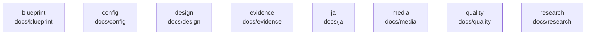

# overall-architecture/n-docs-71ab8b/group-1

[解析トップへ戻る](../../../README.md)

このグループは表示用の区切りです。独立した実行モジュールではありません。

## 要素の説明

### n-docs-blueprint-4e7d66

実在パス: `docs/blueprint`。6ファイル。

- `docs/blueprint/IMPLEMENTATION_BRIEF.md`
- `docs/blueprint/PRODUCT_SPEC.md`
- `docs/blueprint/README.md`
- `docs/blueprint/REFERENCES.md`
- `docs/blueprint/SECURITY.md`
- `docs/blueprint/reference-registry.json`

### n-docs-config-20c893

実在パス: `docs/config`。9ファイル。

- `docs/config/Modelfile.qwen35-9b`
- `docs/config/cost-optimized.yaml`
- `docs/config/local-qwen25-7b-single.yaml`
- `docs/config/local-qwen25-7b-team.yaml`
- `docs/config/local-qwen35-9b-single.yaml`
- `docs/config/local-qwen35-9b-team.yaml`
- `docs/config/local-qwen35-9b-thinking-single.yaml`
- `docs/config/local-qwen35-9b-thinking-team.yaml`
- `docs/config/single-agent.yaml`

### n-docs-design-f63999

実在パス: `docs/design`。5ファイル。

- `docs/design/acceptance.md`
- `docs/design/brief.md`
- `docs/design/references/README.md`
- `docs/design/report-template.md`
- `docs/design/tokens.md`

### n-docs-evidence-3d7bf7

実在パス: `docs/evidence`。815ファイル。

- `docs/evidence/adaptive-team-2026-09-20/architecture-r1.md`
- `docs/evidence/adaptive-team-2026-09-20/communication-budget.json`
- `docs/evidence/adaptive-team-2026-09-20/communication-runtime.json`
- `docs/evidence/adaptive-team-2026-09-20/coordination-finish.json`
- `docs/evidence/adaptive-team-2026-09-20/decisions-r1.md`
- `docs/evidence/adaptive-team-2026-09-20/explicit-voice-recommendation.json`
- `docs/evidence/adaptive-team-2026-09-20/peer-reservation.json`
- `docs/evidence/adaptive-team-2026-09-20/real-recommendation.json`
- `docs/evidence/adaptive-team-2026-09-20/same-owner-output.json`
- `docs/evidence/benchmark-2026-09-13/README.md`
- `docs/evidence/benchmark-2026-09-13/manifest.json`
- `docs/evidence/benchmark-2026-09-13/single-results.jsonl`
- `docs/evidence/benchmark-2026-09-13/single-results.regraded.jsonl`
- `docs/evidence/benchmark-2026-09-13/team-pilot-results.jsonl`
- `docs/evidence/benchmark-2026-09-13/team-results.jsonl`
- `docs/evidence/data-operations-2026-09-14/README.md`
- `docs/evidence/data-operations-2026-09-14/backend-tests.xml`
- `docs/evidence/durable-execution-2026-09-14/README.md`
- `docs/evidence/durable-execution-2026-09-14/actual-queued-request.png`
- `docs/evidence/durable-execution-2026-09-14/cancelled-real-run.json`
- `docs/evidence/durable-execution-2026-09-14/durable-browser.json`
- `docs/evidence/durable-execution-2026-09-14/durable-local.json`
- `docs/evidence/execution-boundaries-2026-09-14/README.md`
- `docs/evidence/execution-boundaries-2026-09-14/backend-tests.xml`
- `docs/evidence/execution-boundaries-2026-09-14/public-fetch.json`

### n-docs-ja-9e2be9

実在パス: `docs/ja`。1ファイル。

- `docs/ja/index.html`

### n-docs-media-17908a

実在パス: `docs/media`。39ファイル。

- `docs/media/app-ask-en.webp`
- `docs/media/app-ask-ja.webp`
- `docs/media/app-results-en.webp`
- `docs/media/app-results-ja.webp`
- `docs/media/app-team-en.webp`
- `docs/media/app-team-ja.webp`
- `docs/media/demo-poster-ja.jpg`
- `docs/media/demo-poster.jpg`
- `docs/media/demo-site-en.vtt`
- `docs/media/demo-site-ja.mp4`
- `docs/media/demo-site-ja.vtt`
- `docs/media/demo-site.mp4`
- `docs/media/demo.gif`
- `docs/media/demo.mp4`
- `docs/media/hero-poster.jpg`
- `docs/media/hero.mp4`
- `docs/media/home.png`
- `docs/media/intro-en.mp4`
- `docs/media/intro.mp4`
- `docs/media/og-ja.png`
- `docs/media/og.png`
- `docs/media/poster-intro-en.jpg`
- `docs/media/poster-intro.jpg`
- `docs/media/poster.jpg`
- `docs/media/real-long-site.png`

### n-docs-quality-8a58ae

実在パス: `docs/quality`。44ファイル。

- `docs/quality/acceptance.md`
- `docs/quality/adaptive-team-independent.md`
- `docs/quality/adaptive-team-status.md`
- `docs/quality/browser-native-zoom.md`
- `docs/quality/characters.md`
- `docs/quality/claims.md`
- `docs/quality/comparative-ui-independent.md`
- `docs/quality/comparative-ui.md`
- `docs/quality/completion-status.md`
- `docs/quality/conversation-processing-independent.md`
- `docs/quality/creation-studio-independent.md`
- `docs/quality/creation-studio.md`
- `docs/quality/delivery-condition-independent.md`
- `docs/quality/desk-redesign-independent.md`
- `docs/quality/document-language-independent.md`
- `docs/quality/document-workflow-independent.md`
- `docs/quality/emoji-icons.md`
- `docs/quality/independent-review.md`
- `docs/quality/integration.md`
- `docs/quality/live-completion.md`
- `docs/quality/local-comparison.md`
- `docs/quality/original-outcome-final.md`
- `docs/quality/original-outcome-independent.md`
- `docs/quality/peer-communication-independent.md`
- `docs/quality/peer-communication.md`

### n-docs-research-847c19

実在パス: `docs/research`。2ファイル。

- `docs/research/trading-cancel-review-addendum.md`
- `docs/research/trading-sources.md`

