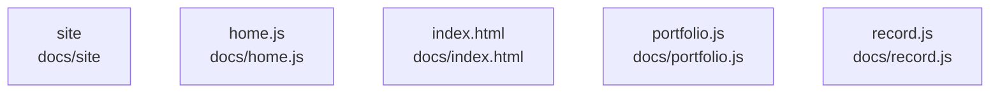

# overall-architecture/n-docs-71ab8b/group-2

[解析トップへ戻る](../../../README.md)

このグループは表示用の区切りです。独立した実行モジュールではありません。

## 要素の説明

### n-docs-home-js-4bde3f

実在パス: `docs/home.js`。1ファイル。

- `docs/home.js`

### n-docs-index-html-8c0d6b

実在パス: `docs/index.html`。1ファイル。

- `docs/index.html`

### n-docs-portfolio-js-0de794

実在パス: `docs/portfolio.js`。1ファイル。

- `docs/portfolio.js`

### n-docs-record-js-219410

実在パス: `docs/record.js`。1ファイル。

- `docs/record.js`

### n-docs-site-5e78da

実在パス: `docs/site`。12ファイル。

- `docs/site/ACCEPTANCE.md`
- `docs/site/CONTENT.md`
- `docs/site/DESIGN.md`
- `docs/site/PRODUCT.md`
- `docs/site/bots-site.css`
- `docs/site/build_site.py`
- `docs/site/variants/hero-a-click.png`
- `docs/site/variants/hero-a-mobile.png`
- `docs/site/variants/hero-a.png`
- `docs/site/variants/hero-b.png`
- `docs/site/variants/hero-c.png`
- `docs/site/variants/hero.html`

