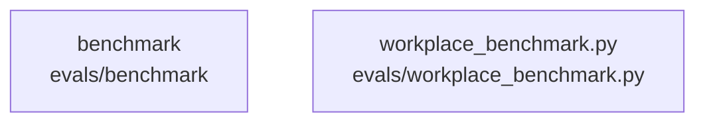

# overall-architecture/n-evals-64bacb

[解析トップへ戻る](../../README.md)

確認したパス: `evals`。配下の登録ファイルは5件。

- `evals/ACCEPTANCE.md`（一覧のみ）
- `evals/RESULTS.md`（一覧のみ）
- `evals/benchmark/tasks.py`（一覧のみ）
- `evals/cases.jsonl`（一覧のみ）
- `evals/workplace_benchmark.py`（一覧のみ）

## 要素の説明

### n-evals-benchmark-2e9de7

実在パス: `evals/benchmark`。1ファイル。

- `evals/benchmark/tasks.py`

### n-evals-workplace-benchmark-py-651b8c

実在パス: `evals/workplace_benchmark.py`。1ファイル。

- `evals/workplace_benchmark.py`

