# overall-architecture/n-frontend-9ecc84/group-1

[解析トップへ戻る](../../../README.md)

このグループは表示用の区切りです。独立した実行モジュールではありません。

```mermaid
graph TD
    n-frontend-public-a7f28f["public\nfrontend/public"]
    n-frontend-scripts-2dc047["scripts\nfrontend/scripts"]
    n-frontend-src-760ff1["src\nfrontend/src"]
    n-frontend-tests-6df2ca["tests\nfrontend/tests"]
    n-frontend-index-html-a12b0e["index.html\nfrontend/index.html"]
    n-frontend-package-json-370830["package.json\nfrontend/package.json"]
    n-frontend-tsconfig-app-json-3c793f["tsconfig.app.json\nfrontend/tsconfig.app.json"]
    n-frontend-tsconfig-json-18471f["tsconfig.json\nfrontend/tsconfig.json"]
```

## 要素の説明

### n-frontend-index-html-a12b0e

実在パス: `frontend/index.html`。1ファイル。

- `frontend/index.html`

### n-frontend-package-json-370830

実在パス: `frontend/package.json`。1ファイル。

- `frontend/package.json`

### n-frontend-public-a7f28f

実在パス: `frontend/public`。2ファイル。

- `frontend/public/favicon.svg`
- `frontend/public/icons.svg`

### n-frontend-scripts-2dc047

実在パス: `frontend/scripts`。54ファイル。

- `frontend/scripts/a11y-smoke.mjs`
- `frontend/scripts/adaptive-team-start.mjs`
- `frontend/scripts/ask-capture.mjs`
- `frontend/scripts/capture-ui-references.mjs`
- `frontend/scripts/comparative-ui-check.mjs`
- `frontend/scripts/completion-conditions-check.mjs`
- `frontend/scripts/completion-download.mjs`
- `frontend/scripts/completion-final-request.mjs`
- `frontend/scripts/completion-original-request.mjs`
- `frontend/scripts/completion-request.mjs`
- `frontend/scripts/completion-start.mjs`
- `frontend/scripts/completion-storage-check.mjs`
- `frontend/scripts/completion-storage-volume-check.mjs`
- `frontend/scripts/conversation-processing-check.mjs`
- `frontend/scripts/creation-studio-check.mjs`
- `frontend/scripts/demo-source.md`
- `frontend/scripts/durable-browser-smoke.mjs`
- `frontend/scripts/edit-demo.mjs`
- `frontend/scripts/elapsed-check.mjs`
- `frontend/scripts/emoji-icons-check.mjs`
- `frontend/scripts/journey-capture.mjs`
- `frontend/scripts/make-captions.mjs`
- `frontend/scripts/make-og.mjs`
- `frontend/scripts/motion-check.mjs`
- `frontend/scripts/oidc-smoke.mjs`

### n-frontend-src-760ff1

実在パス: `frontend/src`。52ファイル。

- `frontend/src/App.tsx`
- `frontend/src/assets/bots/builder.svg`
- `frontend/src/assets/bots/helper.svg`
- `frontend/src/assets/bots/master.svg`
- `frontend/src/assets/bots/reporter.svg`
- `frontend/src/assets/bots/researcher.svg`
- `frontend/src/assets/bots/reviewer.svg`
- `frontend/src/assets/orb-params.txt`
- `frontend/src/assets/orb.LICENSE`
- `frontend/src/assets/orb.html`
- `frontend/src/bot-polish.css`
- `frontend/src/components/ArtifactWorkbench.tsx`
- `frontend/src/components/AuthGate.tsx`
- `frontend/src/components/BotAvatar.tsx`
- `frontend/src/components/BotSettingsCard.tsx`
- `frontend/src/components/ConversationActivity.tsx`
- `frontend/src/components/CustomBotCreator.tsx`
- `frontend/src/components/ElapsedTime.tsx`
- `frontend/src/components/Journey.tsx`
- `frontend/src/components/Markdown.tsx`
- `frontend/src/components/Orb.tsx`
- `frontend/src/components/TeamConversation.tsx`
- `frontend/src/components/WorkProgress.tsx`
- `frontend/src/journey.css`
- `frontend/src/lib/api.ts`

### n-frontend-tests-6df2ca

実在パス: `frontend/tests`。6ファイル。

- `frontend/tests/bot-presentation.test.mjs`
- `frontend/tests/journey.test.mjs`
- `frontend/tests/markdown.test.mjs`
- `frontend/tests/router.test.mjs`
- `frontend/tests/text-delivery.test.mjs`
- `frontend/tests/welcome.test.mjs`

### n-frontend-tsconfig-app-json-3c793f

実在パス: `frontend/tsconfig.app.json`。1ファイル。

- `frontend/tsconfig.app.json`

### n-frontend-tsconfig-json-18471f

実在パス: `frontend/tsconfig.json`。1ファイル。

- `frontend/tsconfig.json`

