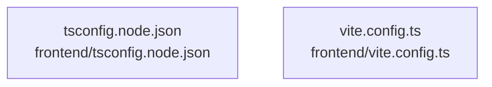

# overall-architecture/n-frontend-9ecc84/group-2

[解析トップへ戻る](../../../README.md)

このグループは表示用の区切りです。独立した実行モジュールではありません。

## 要素の説明

### n-frontend-tsconfig-node-json-824910

実在パス: `frontend/tsconfig.node.json`。1ファイル。

- `frontend/tsconfig.node.json`

### n-frontend-vite-config-ts-90c068

実在パス: `frontend/vite.config.ts`。1ファイル。

- `frontend/vite.config.ts`

