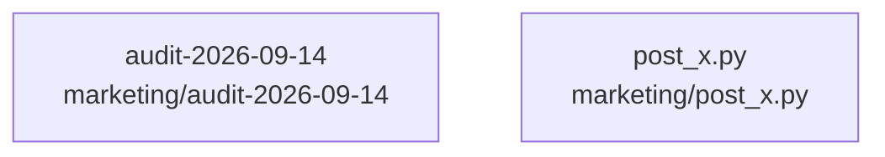

# overall-architecture/n-marketing-a28607

[解析トップへ戻る](../../README.md)

確認したパス: `marketing`。配下の登録ファイルは12件。

- `marketing/LAUNCH.md`（一覧のみ）
- `marketing/POSTED.md`（一覧のみ）
- `marketing/RESEARCH-2026-09-14.md`（一覧のみ）
- `marketing/VALIDATION-2026-09-14.md`（一覧のみ）
- `marketing/ZENN-RESEARCH-2026-09-14.md`（一覧のみ）
- `marketing/audit-2026-09-14/accounts.csv`（一覧のみ）
- `marketing/audit-2026-09-14/activities.csv`（一覧のみ）
- `marketing/audit-2026-09-14/assets.csv`（一覧のみ）
- `marketing/audit-2026-09-14/metrics.csv`（一覧のみ）
- `marketing/audit-2026-09-14/status-audit.md`（一覧のみ）
- `marketing/devto-agent-team-launch.md`（一覧のみ）
- `marketing/post_x.py`（一覧のみ）

## 要素の説明

### n-marketing-audit-2026-09-14-dc4677

実在パス: `marketing/audit-2026-09-14`。5ファイル。

- `marketing/audit-2026-09-14/accounts.csv`
- `marketing/audit-2026-09-14/activities.csv`
- `marketing/audit-2026-09-14/assets.csv`
- `marketing/audit-2026-09-14/metrics.csv`
- `marketing/audit-2026-09-14/status-audit.md`

### n-marketing-post-x-py-234aab

実在パス: `marketing/post_x.py`。1ファイル。

- `marketing/post_x.py`

