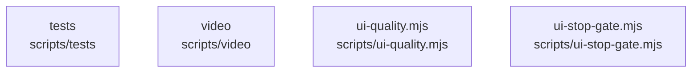

# overall-architecture/n-scripts-16728d

[解析トップへ戻る](../../README.md)

確認したパス: `scripts`。配下の登録ファイルは8件。

- `scripts/tests/ui-gate.test.mjs`（一覧のみ）
- `scripts/ui-quality.mjs`（一覧のみ）
- `scripts/ui-stop-gate.mjs`（一覧のみ）
- `scripts/video/build-intro.sh`（一覧のみ）
- `scripts/video/build-real-walkthrough.sh`（一覧のみ）
- `scripts/video/narration.txt`（一覧のみ）
- `scripts/video/real-walkthrough-ja.txt`（一覧のみ）
- `scripts/video/scenes.html`（一覧のみ）

## 要素の説明

### n-scripts-tests-56c638

実在パス: `scripts/tests`。1ファイル。

- `scripts/tests/ui-gate.test.mjs`

### n-scripts-ui-quality-mjs-6188b0

実在パス: `scripts/ui-quality.mjs`。1ファイル。

- `scripts/ui-quality.mjs`

### n-scripts-ui-stop-gate-mjs-2a2a4e

実在パス: `scripts/ui-stop-gate.mjs`。1ファイル。

- `scripts/ui-stop-gate.mjs`

### n-scripts-video-5dc735

実在パス: `scripts/video`。5ファイル。

- `scripts/video/build-intro.sh`
- `scripts/video/build-real-walkthrough.sh`
- `scripts/video/narration.txt`
- `scripts/video/real-walkthrough-ja.txt`
- `scripts/video/scenes.html`

